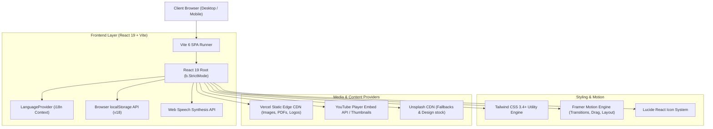
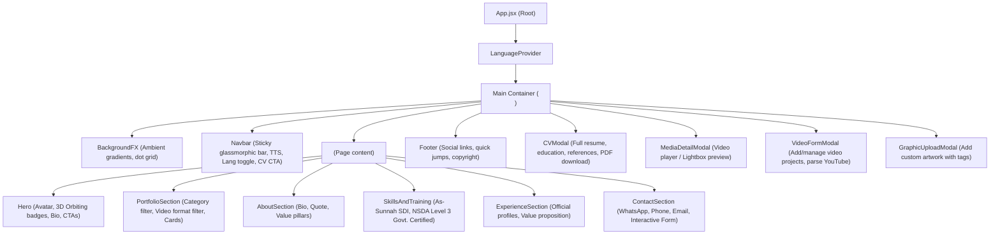
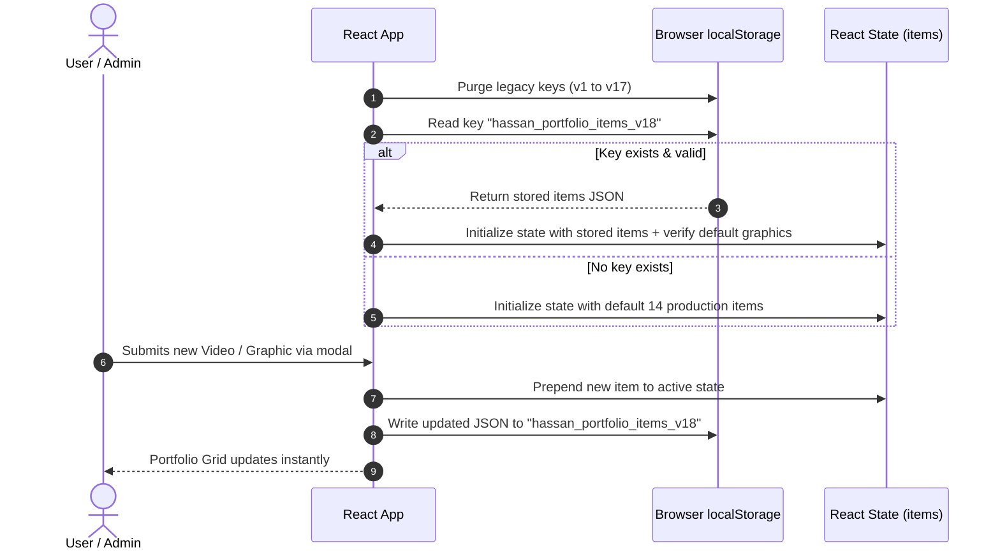
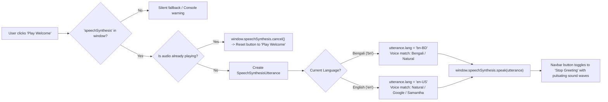

# Hassan Mahmud Portfolio - Architectural Specification & Reverse Engineering Blueprint

This document details the complete system architecture, data models, state lifecycle, component tree, and media pipelines reverse-engineered from `https://hassan-mahmud.vercel.app/`.

---

## 1. System Design & Technology Stack

### Pinned Tool & Library Versions
- **Node.js**: `v22.x` / `v20.x` LTS
- **React**: `^19.0.0`
- **React DOM**: `^19.0.0`
- **Vite**: `^6.0.0`
- **Tailwind CSS**: `^3.4.17`
- **Framer Motion**: `^11.15.0`
- **Lucide React**: `^0.468.0`
- **PostCSS**: `^8.4.49`
- **Autoprefixer**: `^10.4.20`

---

## 2. Component Hierarchy & Flow

---

## 3. Data Flow & LocalStorage Lifecycle

The application adopts a **Zero-Backend / Jamstack** architecture:
1. **Initial Seed**: Default 14 projects (6 video productions + 8 graphic design campaigns) are defined in static JavaScript modules (`portfolioData.js`).
2. **Versioned Migration**: On initial load, keys `hassan_portfolio_items_v1` through `hassan_portfolio_items_v17` are automatically cleaned up to prevent stale data conflicts.
3. **Current Namespace**: `hassan_portfolio_items_v18` stores any user-added or modified portfolio items.
4. **Reactivity**: Any addition through `VideoFormModal` or `GraphicUploadModal` updates React state immediately and serializes to `localStorage`.
5. **Reset Capability**: The user can reset back to factory default items at any time, which purges the key and resets the state.

---

## 4. Audio & Text-to-Speech (TTS) Pipeline

---

## 5. Security & Zero-Trust Posture
- **No Client Secrets Exposed**: No hardcoded production database keys, auth tokens, or private secrets were present in the bundle.
- **Strict Content Isolation**: Embedded videos run inside sandboxed iframes (`https://www.youtube.com/embed/...`, `https://player.vimeo.com/...`, `https://drive.google.com/...`).
- **Sanitized Links**: Outbound links to WhatsApp, Facebook, LinkedIn, Behance, and YouTube include `rel="noopener noreferrer"`.
- **Clean Fallbacks**: External asset failures (e.g. Unsplash or YouTube rate-limits) fall back to local SVG/PNG placeholders stored in `public/`.
