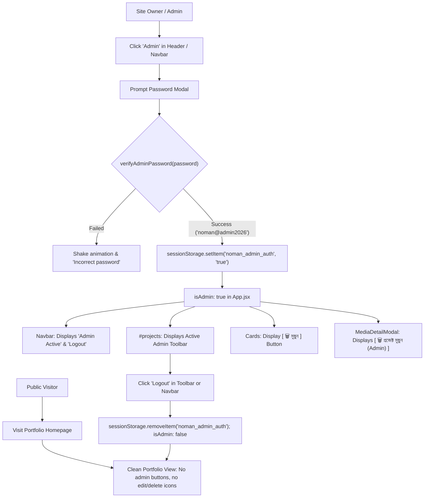

# Admin Role Gating & Header Authentication Specification

## 1. Executive Summary & Objective
Ensure strict separation between public visitor portfolio exploration and administrative content management.
- **Visitor Experience**: Regular users browsing the portfolio must see a 100% clean, distraction-free creative portfolio without administrative action buttons (`+ Add Video`, `+ Add Graphic`, `Admin Studio (Login)`) or deletion controls.
- **Admin Authentication**: Administrative access is initiated exclusively through the **Header / Navbar** (or discrete footer trigger) using the secure admin password `noman@admin2026`.
- **Admin Experience**: Upon successful authentication, the session is unlocked (`isAdmin: true`). The portfolio section reactively displays the glowing Admin Status Toolbar (`CMS Studio`, `+ Add Video`, `+ Add Graphic`, `Logout`), individual card deletion triggers (`[ 🗑️ মুছুন ]`), and modal deletion triggers.
- **Logout Convergence**: Logging out terminates the authenticated session, immediately removing all administrative UI controls and returning the page to the pristine visitor state.

---

## 2. Technical Architecture & State Contracts

### State Flow Diagram


### Component Hierarchy & Prop Signatures
1. **`src/App.jsx`**:
   - `isAdmin`: Boolean reactive state initialized from `sessionStorage.getItem('noman_admin_auth') === 'true'`.
   - `handleLogoutAdmin()`: Clears session, resets `isAdmin` to `false`, displays toast notification.
   - `handleDeleteProject(id, title)`: Confirms deletion, purges from Firestore Cloud (if applicable) and localStorage, updates UI.
2. **`src/components/Navbar.jsx`**:
   - Props: `isAdmin: boolean`, `onOpenAdmin: () => void`, `onLogoutAdmin: () => void`.
   - When `!isAdmin`: Renders discrete `[ 🛡️ Admin ]` trigger.
   - When `isAdmin`: Renders `[ 🛡️ Admin Active ]` and `[ Logout ]` pill.
3. **`src/components/PortfolioSection.jsx`**:
   - Props: `isAdmin: boolean`, `onDeleteItem: (id, title) => void`, `onLogoutAdmin: () => void`.
   - When `!isAdmin`: Does NOT render any admin buttons or login prompts in `#projects` header.
   - When `isAdmin`: Renders active toolbar `[ 🛡️ অ্যাডমিন মোড সক্রিয় ] [ ⚙️ CMS ড্যাশবোর্ড ] [ + ভিডিও যোগ ] [ + গ্রাফিক্স যোগ ] [ 🚪 লগআউট ]`.
   - `PortfolioCard`: Renders red `[ 🗑️ মুছুন ]` button ONLY when `isAdmin === true`.
4. **`src/components/modals/MediaDetailModal.jsx`**:
   - Props: `isAdmin: boolean`, `onDeleteItem: (id, title) => void`.
   - Renders red `[ 🗑️ প্রজেক্ট মুছুন (Admin) ]` button ONLY when `isAdmin === true`.

---

## 3. Gherkin BDD Scenarios

```gherkin
Feature: Admin Role Gating and Header Authentication
  As a portfolio visitor or owner
  I want a clear distinction between public showcase and admin management
  So that visitors see a pristine site while admins can easily manage content

  Scenario: Public visitor views the portfolio
    Given a visitor arrives at the portfolio without an active admin session
    When they scroll to the "#projects" section
    Then they should NOT see "+ Add Video" or "+ Add Graphic" buttons
    And they should NOT see "Admin Studio (Login)" in the portfolio header
    And no delete buttons should appear on any video or graphic cards

  Scenario: Admin logs in via the Header
    Given a site owner wants to manage content
    When they click the "Admin" button in the Navbar
    And they enter "noman@admin2026" in the login modal
    Then the session should authenticate successfully
    And the Navbar should indicate "Admin Active"
    And the "#projects" section should mount the active Admin Toolbar
    And every project card should display a red "[ 🗑️ মুছুন ]" button

  Scenario: Admin deletes an accidentally added project
    Given the admin is authenticated
    When they click the red "[ 🗑️ মুছুন ]" button on a project card
    And confirm the browser deletion dialog
    Then the project should be removed from the display
    And a confirmation toast should appear
    And cloud sync should purge the item if hosted remotely

  Scenario: Admin logs out
    Given an active admin session
    When the admin clicks "Logout" from the toolbar or navbar
    Then "isAdmin" state becomes false
    And all admin toolbars and delete buttons disappear immediately
    And the page returns to the clean visitor showcase
```
