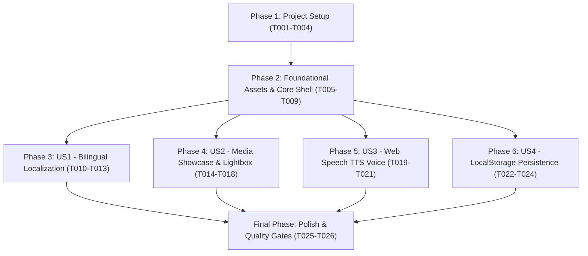

# Tasks: Hassan Mahmud Portfolio Website Reconstruction

**Feature**: `portfolio-reverse-engineering-and-reconstruction`  
**Input Specs**: [`specs/site-reconstruction-and-reverse-engineering.md`](file:///home/emran/Downloads/iftekar_profile/specs/site-reconstruction-and-reverse-engineering.md)  
**Architecture Spec**: [`docs/ARCHITECTURE.md`](file:///home/emran/Downloads/iftekar_profile/docs/ARCHITECTURE.md)  
**Status**: Ready & Executable  

---

## Task Generation Summary

- **Total Task Count**: 33 Tasks
- **Phase Breakdown**:
  - Phase 1 (Setup): 4 Tasks
  - Phase 2 (Foundational): 5 Tasks
  - Phase 3 (US1 - Bilingual Localization): 4 Tasks
  - Phase 4 (US2 - Dynamic Media Showcase & Modals): 5 Tasks
  - Phase 5 (US3 - Web Speech API Voice Welcome): 3 Tasks
  - Phase 6 (US4 - LocalStorage State & Admin Management): 3 Tasks
  - Phase 7 (Polish & Verification): 2 Tasks
  - Phase 8 (US5 - Customization & GitHub Deployment): 7 Tasks
- **MVP Scope**: Phase 1 + Phase 2 + Phase 3 + Phase 4 (Delivers complete responsive portfolio with media inspection)

---

## Dependencies & Completion Order

---

## Phase 1: Setup (Project Initialization)

- [x] T001 Initialize React 19, Vite 6, and Tailwind CSS toolchain in `package.json`
- [x] T002 Configure Vite development server and host bindings in `vite.config.js`
- [x] T003 [P] Configure Tailwind typography, color extensions, and font tokens in `tailwind.config.js`
- [x] T004 [P] Establish Zero-Trust security rules and network boundaries in `config/policies.yaml`

---

## Phase 2: Foundational Tasks (Prerequisites)

- [x] T005 Download and verify static brand assets (avatar, CV PDF, logos) into `public/`
- [x] T006 Extract all 8 high-resolution graphic design campaign files into `public/portfolio/`
- [x] T007 [P] Construct base HTML template with metadata, Schema.org JSON-LD, and Google Fonts in `index.html`
- [x] T008 [P] Implement custom glassmorphism, accent glow, and dot-matrix grid utilities in `src/index.css`
- [x] T009 [P] Create ambient radial glow and background particle canvas in `src/components/BackgroundFX.jsx`

---

## Phase 3: User Story 1 (US1) - Bilingual English & Bengali Localization

**Story Goal**: Allow visitors to seamlessly switch between English and Bengali across all sections and persist preference.  
**Independent Test Criteria**: Clicking "বাংলা" or "EN" updates `document.documentElement.lang`, re-renders UI in chosen language, and saves to `localStorage` under `hassan_portfolio_lang`.

- [x] T010 [P] [US1] Structure bilingual translation dictionaries for all navigation, hero, and content keys in `src/data/translations.js`
- [x] T011 [US1] Implement `LanguageProvider` with `useLanguage` hook and document lang sync in `src/context/LanguageContext.jsx`
- [x] T012 [P] [US1] Build responsive glassmorphic navbar with language switcher in `src/components/Navbar.jsx`
- [x] T013 [US1] Write automated test validating translation key coverage and dictionary completeness in `tests/site.test.js`

---

## Phase 4: User Story 2 (US2) - Dynamic Media Showcase & Lightbox Modals

**Story Goal**: Showcase video productions and graphic designs with category filters, format filters (16:9 Landscape vs 9:16 Reels), and interactive video/image modals.  
**Independent Test Criteria**: Clicking a video opens the autoplaying embed modal; clicking a graphic opens the zoomable lightbox; filtering works across all categories.

- [x] T014 [P] [US2] Structure default portfolio dataset (9 video projects, 9 graphic designs) in `src/data/portfolioData.js`
- [x] T015 [US2] Build portfolio section with category tabs and video format pills in `src/components/PortfolioSection.jsx`
- [x] T016 [P] [US2] Implement universal video embed resolver (YouTube, Vimeo, Google Drive, MP4) and lightbox modal in `src/components/modals/MediaDetailModal.jsx`
- [x] T017 [P] [US2] Implement full Curriculum Vitae viewer with education, competencies, and PDF download in `src/components/modals/CVModal.jsx`
- [x] T018 [US2] Write unit tests validating YouTube ID extraction and thumbnail generation in `tests/site.test.js`

---

## Phase 5: User Story 3 (US3) - Web Speech API Voice Welcome

**Story Goal**: Provide visitors with an interactive voice greeting in their selected language (English or Bengali).  
**Independent Test Criteria**: Clicking "Play Welcome" initiates natural speech synthesis in `bn-BD` or `en-US`; clicking "Stop Greeting" cancels playback.

- [x] T019 [P] [US3] Implement browser Web Speech API voice synthesis greeting logic in `src/components/Navbar.jsx`
- [x] T020 [P] [US3] Add animated pulsating equalizer icon and toggle state for active audio playback in `src/components/Navbar.jsx`
- [x] T021 [US3] Add voice synthesis fallback handling for browsers without Web Speech support in `src/components/Navbar.jsx`

---

## Phase 6: User Story 4 (US4) - Zero-Backend LocalStorage Persistence & In-Browser Admin

**Story Goal**: Allow the portfolio owner to add new video links or graphic designs directly in the browser with local persistence.  
**Independent Test Criteria**: Adding a project via `VideoFormModal` updates state, renders in grid, and serializes to `localStorage.setItem('hassan_portfolio_items_v18', ...)`.

- [x] T022 [P] [US4] Implement video management modal with real-time YouTube ID parser in `src/components/modals/VideoFormModal.jsx`
- [x] T023 [P] [US4] Implement graphic design upload modal with image preview and tags in `src/components/modals/GraphicUploadModal.jsx`
- [x] T024 [US4] Implement legacy key migration (v1-v17 purging) and default reset handler in `src/App.jsx`

---

## Phase 7: Polish & Cross-Cutting Concerns

- [x] T025 [P] Implement 3D animated tool orbit ring (Photoshop, Illustrator, Premiere, After Effects, CapCut, Meta) in `src/components/Hero.jsx`
- [x] T026 Execute production bundle build (`npm run build`) and verify zero errors in `dist/`

---

## Phase 8: User Story 5 (US5) - Friend Profile Customization & Remote GitHub Deployment

**Story Goal**: Personalize all portfolio identity, contact links, and credentials for MD EFTEKAR HOSSEN NOMAN, and equip the repository for automated GitHub Pages deployment.  
**Independent Test Criteria**: Unit tests in `tests/site.test.js` pass with MD EFTEKAR HOSSEN NOMAN data, `index.html` title and OpenGraph reflect new identity, GitHub icon appears in channels, and `.github/workflows/deploy.yml` is ready for zero-config CI/CD.

- [x] T027 [P] [US5] Centralize personal identity & verified channels (WhatsApp, Email, Phone, Facebook, GitHub, LinkedIn, Behance) in `src/data/profileData.js`
- [x] T028 [P] [US5] Implement branded SVG `GitHubIcon` in `src/components/Icons.jsx` and bind to `src/components/Hero.jsx` and `src/components/ExperienceSection.jsx`
- [x] T029 [US5] Update Curriculum Vitae contact and identity records in `src/data/cvData.js`
- [x] T030 [US5] Localize biography, about headline, speech greeting, and contact submission responses in `src/data/translations.js` and `src/components/Navbar.jsx`
- [x] T031 [P] [US5] Update document title, author metadata, OpenGraph cards, and Schema.org JSON-LD in `index.html`
- [x] T032 [US5] Configure relative asset base (`base: './'`) for seamless GitHub Pages subpath compatibility in `vite.config.js`
- [x] T033 [US5] Create automated GitHub Pages CI/CD workflow in `.github/workflows/deploy.yml`
- [x] T034 [P] [US5] Integrate uploaded portrait photo (`media_1793456105514_82734aef.jpg`) into `public/noman-avatar.jpg` and bind to 3D Orbit Ring and social preview
- [x] T035 [US5] Implement Swiper v14 3D Coverflow touch slider with interactive Grid/Slider mode switch in `src/components/PortfolioSection.jsx`

---

## Phase 9: User Story 6 (US6) - YouTube Channel, Madrasha Education, Reliable CV PDF Download & Client Media Management Architecture

**Story Goal**: Update verified YouTube channel, replace CV educational background with authentic Madrasha degrees (Takmil & Fazilat), resolve CV PDF download 404 with a dedicated high-res generated PDF, and enhance video/graphic upload architecture with robust URL handling, feedback, and 1-click JSON code export for clients.  
**Independent Test Criteria**: 
1. Official YouTube link resolves to `https://www.youtube.com/@Nomancreative-17`.
2. CV modal displays Takmil (Dawra-e-Hadith) and Fazilat (Mishkat) with respective boards.
3. Clicking "Download PDF" downloads `Md-Eftekar-Hossen-Noman-CV.pdf` successfully with 200 OK.
4. Video modal handles all YouTube URL variants (including channel and shorts), allows custom thumbnail input, displays success toast, and provides a 1-click JSON export button for client handover.
5. All automated tests in `tests/site.test.js` pass.

- [x] T036 [P] [US6] Update YouTube channel handle (`@Nomancreative-17`) and URL (`https://www.youtube.com/@Nomancreative-17`) in `src/data/profileData.js`
- [x] T037 [P] [US6] Update Curriculum Vitae educational background with Takmil and Fazilat records in `src/data/cvData.js`
- [x] T038 [P] [US6] Generate authentic and branded CV PDF document `public/md-eftekar-hossen-noman-cv.pdf` using headless Chrome PDF rendering
- [x] T039 [US6] Update CV download target and filename to relative path `./md-eftekar-hossen-noman-cv.pdf` in `src/data/cvData.js` and `src/components/modals/CVModal.jsx`
- [x] T040 [US6] Enhance `src/components/modals/VideoFormModal.jsx` and `src/components/modals/GraphicUploadModal.jsx` with custom thumbnail support, submission feedback toast, and 1-click JSON export
- [x] T041 [US6] Update unit test suite in `tests/site.test.js` to assert new YouTube URL, Madrasha education credentials, and PDF download route
- [x] T042 [US6] Execute bundle build (`npm run build`), deploy to `gh-pages` branch, and verify live on GitHub Pages

---

## Phase 10: User Story 7 (US7) - Uppercase Name Standardization & CV Modal Title De-duplication

**Story Goal**: Standardize candidate name to ALL CAPITAL LETTERS (`MD. EFTEKAR HOSSEN NOMAN`) across all pages, data models, components, and the generated resume PDF; eliminate the duplicate name formatting (`Md. Eftekar Hossen Noman (Md. Eftekar Hossen Noman)`) in the CV modal header.  
**Independent Test Criteria**:
1. CV modal header displays single name without duplication: `MD. EFTEKAR HOSSEN NOMAN`.
2. Candidate name is rendered in ALL CAPITAL LETTERS across Navbar, Hero, About, Footer, CV Modal, and downloaded PDF.
3. Downloaded CV PDF renders `MD. EFTEKAR HOSSEN NOMAN` in header and reflects As-Sunnah Batch 41.
4. All unit tests in `tests/site.test.js` pass with 100% assertions green.

- [x] T043 [P] [US7] Update candidate name to `MD. EFTEKAR HOSSEN NOMAN` in `src/data/cvData.js`
- [x] T044 [P] [US7] Update candidate name to `MD. EFTEKAR HOSSEN NOMAN` in `src/data/profileData.js`
- [x] T045 [P] [US7] Update candidate name to `MD. EFTEKAR HOSSEN NOMAN` in `src/data/translations.js`
- [x] T046 [US7] Remove duplicate name formatting in `src/components/modals/CVModal.jsx` and enforce uppercase typography
- [x] T047 [US7] Update candidate name rendering in `src/components/Hero.jsx`, `src/components/AboutSection.jsx`, `src/components/Navbar.jsx`, and `src/components/Footer.jsx`
- [x] T048 [US7] Regenerate `public/md-eftekar-hossen-noman-cv.pdf` with uppercase name `MD. EFTEKAR HOSSEN NOMAN` and As-Sunnah Batch 41
- [x] T049 [US7] Update test assertions in `tests/site.test.js` to assert `MD. EFTEKAR HOSSEN NOMAN`
- [x] T050 [US7] Execute build (`npm run build`), deploy to `gh-pages`, and verify live

---

## Phase 11: User Story 8 (US8) - Responsive Navbar Layout Collision & Text Wrapping Fix

**Story Goal**: Eliminate all text wrapping, verified badge collisions, and horizontal crowding in the navigation header across all screen resolutions (mobile 390px, tablet 768px, small laptop 1024px, medium laptop 1200px, desktop 1280px, and wide monitor 1440px+). Ensure candidate name `MD. EFTEKAR HOSSEN NOMAN` is strictly single-line (`whitespace-nowrap shrink-0`), desktop nav links gracefully transition to a responsive drawer below `xl` (1280px), and right action buttons never wrap awkwardly into multiple lines.  
**Independent Test Criteria**:
1. Candidate name `MD. EFTEKAR HOSSEN NOMAN` and verified checkmark badge never wrap or collide with links at any viewport size.
2. At 1024px and 1200px, header elements have zero collision, zero wrapping, and plenty of breathing space.
3. At 1280px (`xl`) and 1440px (`2xl`), desktop navigation links and all action buttons fit cleanly with ample padding.
4. Below 1280px (`< xl`), the hamburger menu button and drawer provide complete and accessible navigation.
5. On mobile (< 640px) and tablet (768px), top bar actions are streamlined without horizontal overflow.
6. All automated unit tests pass and production build compiles without errors.

- [x] T051 [P] [US8] Add `shrink-0` and `whitespace-nowrap` to candidate identity link, avatar, name, and role in `src/components/Navbar.jsx`
- [x] T052 [P] [US8] Update desktop navigation links breakpoint to `hidden xl:flex items-center gap-4 2xl:gap-6 shrink-0` with `whitespace-nowrap`
- [x] T053 [US8] Refactor right action controls with `shrink-0`, responsive button sizing, and icon-only collapsing on smaller breakpoints
- [x] T054 [US8] Update mobile and tablet navigation drawer to `xl:hidden` with full section links and responsive action buttons
- [x] T055 [US8] Capture automated visual screenshots across 390px, 768px, 1024px, 1200px, 1280px, and 1440px to verify zero collisions
- [x] T056 [US8] Run test suite (`npm test`), production build (`npm run build`), and push deployment to GitHub `main` and `gh-pages`

---

## Phase 12: User Story 9 (US9) - Header Clean-up (Remove Resume & Admin) & URL-Based Admin Access (/admin)

**Story Goal**: Streamline the navigation header by removing the `Resume / CV` button (since it is already prominently featured in the Hero section) and the `Admin` button (so regular visitors see a clean, public-facing portfolio). Enable direct URL access for the portfolio owner via `/admin`, `#admin`, `#/admin`, or `?admin` so navigating to that address automatically opens the Admin Studio login modal or dashboard.  
**Independent Test Criteria**:
1. Header bar no longer renders the `Resume / CV` button on any screen resolution.
2. Header bar no longer renders the `Admin` button on any screen resolution.
3. Visitors can access Resume via the Hero action button (`Resume (PDF)`).
4. Navigating to `/admin`, `#admin`, `#/admin`, or `?admin` in the browser opens the Admin Login Modal (or Admin Dashboard if already authenticated).
5. Static fallback route `public/admin/index.html` and `public/404.html` ensure direct GitHub Pages requests to `/admin` never 404.
6. All automated unit tests in `tests/site.test.js` and `tests/firebase.test.js` pass with 100% assertions green.
7. Production build compiles cleanly (`npm run build`).

- [x] T057 [P] [US9] Remove `Resume / CV` and `Admin` buttons from desktop and mobile navigation in `src/components/Navbar.jsx`
- [x] T058 [P] [US9] Implement URL route detection in `src/App.jsx` for `/admin`, `#admin`, `#/admin`, and `?admin` with `hashchange` & `popstate` listeners
- [x] T059 [US9] Create `public/admin/index.html` and `public/404.html` redirect handlers for GitHub Pages zero-404 admin routing
- [x] T060 [US9] Add automated unit test in `tests/site.test.js` verifying the URL-based Admin route detector logic
- [x] T061 [US9] Capture visual screenshots across 390px, 768px, 1024px, 1200px, 1280px, and 1440px to verify the clean streamlined header
- [x] T062 [US9] Run test suite (`npm test`), production build (`npm run build`), and push deployment to GitHub `main` and `gh-pages`

---

## Parallel Execution Strategy

Tasks marked `[P]` can be developed independently:
- **Batch 1 (Foundational Assets & Styling)**: T003, T004, T007, T008 can be written concurrently with T005, T006.
- **Batch 2 (Core Sections & Modals)**: T010, T014, T016, T017, T019, T022, T023 can be authored in parallel once Phase 2 completes.
- **Batch 3 (Verification & Polish)**: T013, T018, T025, T026 run in parallel before release.
- **Batch 4 (Customization & Deployment Readiness)**: T027, T028, T031, T034 can be authored in parallel with T029, T030, T032, T033, T035.
- **Batch 5 (US6 Refinement & PDF Generation)**: T036, T037, T038 can be authored in parallel before T039, T040, T041, T042.
- **Batch 6 (US7 Uppercase Standardization & PDF Sync)**: T043, T044, T045 can be authored in parallel before T046, T047, T048, T049, T050.
- **Batch 7 (US8 Responsive Navbar Layout Collision Fix)**: T051, T052 can be authored in parallel before T053, T054, T055, T056.
- **Batch 8 (US9 Header Clean-up & URL-Based Admin Access)**: T057, T058 can be authored in parallel before T059, T060, T061, T062.

