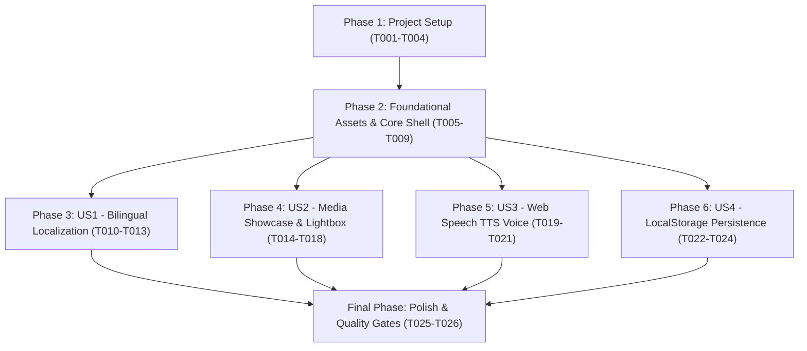

# Tasks: Hassan Mahmud Portfolio Website Reconstruction

**Feature**: `portfolio-reverse-engineering-and-reconstruction`  
**Input Specs**: [`specs/site-reconstruction-and-reverse-engineering.md`](file:///home/emran/Downloads/iftekar_profile/specs/site-reconstruction-and-reverse-engineering.md)  
**Architecture Spec**: [`docs/ARCHITECTURE.md`](file:///home/emran/Downloads/iftekar_profile/docs/ARCHITECTURE.md)  
**Status**: Ready & Executable  

---

## Task Generation Summary

- **Total Task Count**: 33 Tasks
- **Phase Breakdown**:
  - Phase 1 (Setup): 4 Tasks
  - Phase 2 (Foundational): 5 Tasks
  - Phase 3 (US1 - Bilingual Localization): 4 Tasks
  - Phase 4 (US2 - Dynamic Media Showcase & Modals): 5 Tasks
  - Phase 5 (US3 - Web Speech API Voice Welcome): 3 Tasks
  - Phase 6 (US4 - LocalStorage State & Admin Management): 3 Tasks
  - Phase 7 (Polish & Verification): 2 Tasks
  - Phase 8 (US5 - Customization & GitHub Deployment): 7 Tasks
- **MVP Scope**: Phase 1 + Phase 2 + Phase 3 + Phase 4 (Delivers complete responsive portfolio with media inspection)

---

## Dependencies & Completion Order

---

## Phase 1: Setup (Project Initialization)

- [x] T001 Initialize React 19, Vite 6, and Tailwind CSS toolchain in `package.json`
- [x] T002 Configure Vite development server and host bindings in `vite.config.js`
- [x] T003 [P] Configure Tailwind typography, color extensions, and font tokens in `tailwind.config.js`
- [x] T004 [P] Establish Zero-Trust security rules and network boundaries in `config/policies.yaml`

---

## Phase 2: Foundational Tasks (Prerequisites)

- [x] T005 Download and verify static brand assets (avatar, CV PDF, logos) into `public/`
- [x] T006 Extract all 8 high-resolution graphic design campaign files into `public/portfolio/`
- [x] T007 [P] Construct base HTML template with metadata, Schema.org JSON-LD, and Google Fonts in `index.html`
- [x] T008 [P] Implement custom glassmorphism, accent glow, and dot-matrix grid utilities in `src/index.css`
- [x] T009 [P] Create ambient radial glow and background particle canvas in `src/components/BackgroundFX.jsx`

---

## Phase 3: User Story 1 (US1) - Bilingual English & Bengali Localization

**Story Goal**: Allow visitors to seamlessly switch between English and Bengali across all sections and persist preference.  
**Independent Test Criteria**: Clicking "বাংলা" or "EN" updates `document.documentElement.lang`, re-renders UI in chosen language, and saves to `localStorage` under `hassan_portfolio_lang`.

- [x] T010 [P] [US1] Structure bilingual translation dictionaries for all navigation, hero, and content keys in `src/data/translations.js`
- [x] T011 [US1] Implement `LanguageProvider` with `useLanguage` hook and document lang sync in `src/context/LanguageContext.jsx`
- [x] T012 [P] [US1] Build responsive glassmorphic navbar with language switcher in `src/components/Navbar.jsx`
- [x] T013 [US1] Write automated test validating translation key coverage and dictionary completeness in `tests/site.test.js`

---

## Phase 4: User Story 2 (US2) - Dynamic Media Showcase & Lightbox Modals

**Story Goal**: Showcase video productions and graphic designs with category filters, format filters (16:9 Landscape vs 9:16 Reels), and interactive video/image modals.  
**Independent Test Criteria**: Clicking a video opens the autoplaying embed modal; clicking a graphic opens the zoomable lightbox; filtering works across all categories.

- [x] T014 [P] [US2] Structure default portfolio dataset (9 video projects, 9 graphic designs) in `src/data/portfolioData.js`
- [x] T015 [US2] Build portfolio section with category tabs and video format pills in `src/components/PortfolioSection.jsx`
- [x] T016 [P] [US2] Implement universal video embed resolver (YouTube, Vimeo, Google Drive, MP4) and lightbox modal in `src/components/modals/MediaDetailModal.jsx`
- [x] T017 [P] [US2] Implement full Curriculum Vitae viewer with education, competencies, and PDF download in `src/components/modals/CVModal.jsx`
- [x] T018 [US2] Write unit tests validating YouTube ID extraction and thumbnail generation in `tests/site.test.js`

---

## Phase 5: User Story 3 (US3) - Web Speech API Voice Welcome

**Story Goal**: Provide visitors with an interactive voice greeting in their selected language (English or Bengali).  
**Independent Test Criteria**: Clicking "Play Welcome" initiates natural speech synthesis in `bn-BD` or `en-US`; clicking "Stop Greeting" cancels playback.

- [x] T019 [P] [US3] Implement browser Web Speech API voice synthesis greeting logic in `src/components/Navbar.jsx`
- [x] T020 [P] [US3] Add animated pulsating equalizer icon and toggle state for active audio playback in `src/components/Navbar.jsx`
- [x] T021 [US3] Add voice synthesis fallback handling for browsers without Web Speech support in `src/components/Navbar.jsx`

---

## Phase 6: User Story 4 (US4) - Zero-Backend LocalStorage Persistence & In-Browser Admin

**Story Goal**: Allow the portfolio owner to add new video links or graphic designs directly in the browser with local persistence.  
**Independent Test Criteria**: Adding a project via `VideoFormModal` updates state, renders in grid, and serializes to `localStorage.setItem('hassan_portfolio_items_v18', ...)`.

- [x] T022 [P] [US4] Implement video management modal with real-time YouTube ID parser in `src/components/modals/VideoFormModal.jsx`
- [x] T023 [P] [US4] Implement graphic design upload modal with image preview and tags in `src/components/modals/GraphicUploadModal.jsx`
- [x] T024 [US4] Implement legacy key migration (v1-v17 purging) and default reset handler in `src/App.jsx`

---

## Phase 7: Polish & Cross-Cutting Concerns

- [x] T025 [P] Implement 3D animated tool orbit ring (Photoshop, Illustrator, Premiere, After Effects, CapCut, Meta) in `src/components/Hero.jsx`
- [x] T026 Execute production bundle build (`npm run build`) and verify zero errors in `dist/`

---

## Phase 8: User Story 5 (US5) - Friend Profile Customization & Remote GitHub Deployment

**Story Goal**: Personalize all portfolio identity, contact links, and credentials for MD EFTEKAR HOSSEN NOMAN, and equip the repository for automated GitHub Pages deployment.  
**Independent Test Criteria**: Unit tests in `tests/site.test.js` pass with MD EFTEKAR HOSSEN NOMAN data, `index.html` title and OpenGraph reflect new identity, GitHub icon appears in channels, and `.github/workflows/deploy.yml` is ready for zero-config CI/CD.

- [x] T027 [P] [US5] Centralize personal identity & verified channels (WhatsApp, Email, Phone, Facebook, GitHub, LinkedIn, Behance) in `src/data/profileData.js`
- [x] T028 [P] [US5] Implement branded SVG `GitHubIcon` in `src/components/Icons.jsx` and bind to `src/components/Hero.jsx` and `src/components/ExperienceSection.jsx`
- [x] T029 [US5] Update Curriculum Vitae contact and identity records in `src/data/cvData.js`
- [x] T030 [US5] Localize biography, about headline, speech greeting, and contact submission responses in `src/data/translations.js` and `src/components/Navbar.jsx`
- [x] T031 [P] [US5] Update document title, author metadata, OpenGraph cards, and Schema.org JSON-LD in `index.html`
- [x] T032 [US5] Configure relative asset base (`base: './'`) for seamless GitHub Pages subpath compatibility in `vite.config.js`
- [x] T033 [US5] Create automated GitHub Pages CI/CD workflow in `.github/workflows/deploy.yml`
- [x] T034 [P] [US5] Integrate uploaded portrait photo (`media_1793456105514_82734aef.jpg`) into `public/noman-avatar.jpg` and bind to 3D Orbit Ring and social preview
- [x] T035 [US5] Implement Swiper v14 3D Coverflow touch slider with interactive Grid/Slider mode switch in `src/components/PortfolioSection.jsx`

---

## Parallel Execution Strategy

Tasks marked `[P]` can be developed independently:
- **Batch 1 (Foundational Assets & Styling)**: T003, T004, T007, T008 can be written concurrently with T005, T006.
- **Batch 2 (Core Sections & Modals)**: T010, T014, T016, T017, T019, T022, T023 can be authored in parallel once Phase 2 completes.
- **Batch 3 (Verification & Polish)**: T013, T018, T025, T026 run in parallel before release.
- **Batch 4 (Customization & Deployment Readiness)**: T027, T028, T031, T034 can be authored in parallel with T029, T030, T032, T033, T035.

